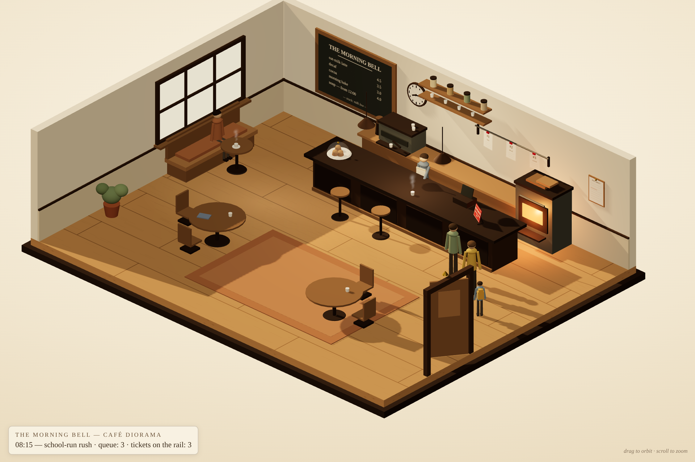

# Café trace player — build report

**Date:** Oct 27, 2026 · **Scope:** `examples/cafe3d/` only ·
**Gate it answers:** *the trace-player follow-on to the diorama
spike, approved when the spike landed* · **Verdict: built and
verified.** The spike's café now replays a run. Two filmstrips of
the same canonical Day — one per compaction harness — play in the
same room, under the same camera, and the difference between them
is exactly one dropped `CONSTRAINT` line.

Everything below was checked headlessly from `file://` (the rig
from the spike: local headless Chromium, SwiftShader WebGL,
console errors treated as failures). **Zero console errors on
every capture in this report.**

---

## Delivered

| File | What it is |
|---|---|
| `export_filmstrips.py` | The exporter. Runs the real course machinery and writes the two filmstrips. Stdlib only. |
| `filmstrip_careful.json` / `filmstrip_gist.json` | The filmstrips (spec below). |
| `filmstrips.js` | The same two filmstrips as a script-tag include (`window.FILMSTRIPS`) — this is what makes double-click playback work from `file://`, where `fetch` of a sibling JSON is blocked. |
| `scene.js` | **The scene, as a module — the single source.** Exports `createCafe(THREE, OrbitControls, mount, initialState)`, `FROZEN_STATE`, `mountStaticScene`. This is the spike's scene code, extended with `applyState`. |
| `player_logic.js` | The transport (source form; inlined into `player.html`). |
| `index.template.html` / `player.template.html` | Page shells. |
| `build_pages.py` | Splices `scene.js` (and `player_logic.js`) into the templates. Edit the sources, re-run it: `python3 examples/cafe3d/build_pages.py`. |
| `index.html` | The spike's frozen 08:15 scene — rebuilt from the shared scene code, **verified pixel-faithful** (below). |
| `player.html` | The trace player. Self-contained except the Three.js CDN, like the spike. |
| `player_demo.ipynb` | The embed demo: one display cell, careful filmstrip, `snapshot.png` poster fallback. |
| `verification_player_*.png` | The proof frames (below). |

Why the inlining step exists: a learner double-clicks these
pages. An ES-module import of a sibling `scene.js` is blocked
from `file://` in Chrome, while one inline module plus the CDN
importmap is not — the spike's constraint, kept. So `scene.js`
is the source of truth, and the shipped pages are builds of it.

---

## The filmstrips — format spec

Envelope (format id `cafe3d-filmstrip/1`):

```json
{
  "format": "cafe3d-filmstrip/1",
  "id": "careful" | "gist",
  "title": "…", "harness_note": "…",
  "day": "the-day", "seed": "morning-bell-0001-bell",
  "mode": "checkpoint",
  "machinery": "…(exact provenance string)…",
  "scoreboard": { "tickets_completed": 8, "tickets_missed": 0,
                  "violations": 0, "allergy_incidents": 0, "…": "…" },
  "steps": [ … ]
}
```

Each step:

| Field | Meaning |
|---|---|
| `n` | 1-based step number (the course's trace numbering). |
| `step_id` | `step-N` — chapter 7's step identity. |
| `clock` | Sim time after the step, `HH:MM`. |
| `caption` | The step's sentence, written from the world delta. |
| `trace` | The numbered trace line the player displays: `step-N · HH:MM · caption`, with `· violation: <detail>` appended on failure steps. |
| `action` | `{verb, ticket?, item?}` — the world action the policy took (`serve_ticket`, `place_on_prep`, `clear_prep`, `tick`, `close_day`, …). |
| `state` | The diorama state (below). |
| `threat` | True while a peanut item sits at the prep counter. |
| `violation` | `null`, or `{kind, detail}` — `constraint` on the place, `allergy` on the serve. |

`state` extends the spike's STATE vocabulary:

```json
{
  "clock": "08:15",
  "rail": [ {"id": "t3", "n": 3, "item": "cocoa",
             "label": "School-run parent"} ],
  "completed": ["t1", "t2"],
  "figures": [ {"key": "cust:t3", "kind": "adult",
                "where": "queue:0", "label": "School-run parent"} ],
  "tab": {"station": "counter", "action": "ticket t3 arrives",
          "holding": null},
  "prep": [], "stock": {"milk": "low", "…": "…"},
  "stockNote": "stock: milk low", "threat": false
}
```

- `figures[].where` is a station name the scene maps to a floor
  anchor: `door`, `queue:0…4`, `pass`, `seat:window`,
  `seat:stool`, `seat:table`, `seat:table2`. `kind` is `adult`,
  `sasha` (the window regular's sweater), or `kid` (Mina —
  shorter, backpack). A customer the world has served is staged
  at `pass` for that step, then walks out on the next.
- `tab.station` ∈ `counter | pass | prep | oven | till`;
  `tab.holding` is `a cup`, `the peanut crunch jar`, or `null`.
- `stockNote` is the chalkboard's bottom line, redrawn live;
  `stock` travels with the state for future use (order steps).
- The frozen spike scene is the same vocabulary: `FROZEN_STATE`
  in `scene.js` is the 08:15 moment written in it.

### What machinery generated them — exactly

`export_filmstrips.py` drives `shared.cafe_world.CafeWorld(
"the-day")` (canonical seed `morning-bell-0001-bell`, checkpoint
mode — the world's own `snapshot()` vocabulary), one action at a
time, through a `RecordingWorld(CafeWorld)` subclass that
snapshots the world after every public action and dedupes
unchanged worlds. The policies are
**`examples/architecture_lab.py`'s `pinned_policy` and
`gist_policy`**, unmodified — the lab's own pair for "the same
Day, constraint kept vs gist-compacted away," which the lab
calls Careful Tab and Rush Tab. Its pinned policy carries
chapter 3's `CONSTRAINT` lines verbatim (the pinned/anchored
compaction); its gist policy is chapter 3's gist failure with
the constraint in no summary.

Disclosure, as agreed in the brief: chapter 3's *literal*
harness operates on message lists and cannot drive the world;
chapter 11's harnesses mirror into it. The architecture lab is
the course machinery built for precisely this contrast on this
world, so it is what runs. The contrast the brief requires —
same Day, constraint kept vs lost, Mina's cocoa at 10:00 — is
produced by the world itself: at step 13 the gist policy places
**peanut crunch topping** at the prep counter (the world records
a constraint violation), and at step 14 it serves Mina's ticket
t6 (the world records an allergy incident). The careful run
clears the prep counter at the same minute and serves her
clean. Nothing in either filmstrip is hand-authored: every
state is a world snapshot, and every violation is the world's
own scoreboard speaking.

### Determinism

The exporter was run twice end-to-end; outputs are
byte-identical.

| File | sha256 |
|---|---|
| `filmstrip_careful.json` | `9bb95ff9118699e9b75ef06c41cf588b7718cac267a4b790bf25eb6dc676cefb` |
| `filmstrip_gist.json` | `4faef99336a8a8df5079d8938c937106574f3a9d9b0202452e1c6686aad396f2` |
| `filmstrips.js` | `da334b0db397011a34b8a8097bee6f4cc374e57ef762ebeca31bf9aa1a87d622` |

Both filmstrips: **19 steps, 06:30 → close (13:00)** — the full
Day, not a truncated segment (the machinery reached well past
the 08:15 rush and the 10:00 school group, so the scope grew to
the whole Day; the contrast still lands at 10:00). Careful:
8/8 tickets, violations 0, allergy incidents 0. Gist: 8/8
tickets, **violations 2, allergy incidents 1** — the day
*completes* in both runs; only the careful one completes
*safely*. That sameness is the lesson.

---

## The player

`player.html`: same room, same camera (full-turn auto-rotate,
same limits), same art. On top:

- **Transport** — play/pause (spacebar), step forward/back
  (arrow keys), a scrubber over all 19 steps, speed
  0.5×/1×/2×/4× (1.75 s per step at 1×), and the step readout
  (`step 14 / 19 · 10:02`).
- **The trace caption** — every step shows its numbered trace
  line, the course's trace identity, in the caption card.
- **The switcher** — Careful Tab / Gist Tab buttons restart the
  same morning under the other harness; the transport bar also
  carries the world's own grading of the run ("8/8 tickets ·
  violations 2 · allergy incidents 1"). Switching hard-resets
  the cast: the other morning's guests do not linger.
- **Motion** — figures glide between anchors at walking pace
  with a small step-bob; entering figures come through the door,
  served customers leave through it; seated figures rebuild in
  seated posture on arrival. Tickets fade onto and off the rail
  (spread across it as the count changes), the clock hands are
  driven by state, and the chalkboard's stock line redraws when
  the state changes it.
- **The failure, staged plainly** — on the gist run's step 13,
  Tab carries the topping jar to the prep station and the jar
  appears on the back counter; on any step where the state
  carries a threat the red card breathes (a slow emissive
  pulse), and on a violation step the pulse strengthens, a red
  light pools on the counter around the card, and the caption
  card goes alarm-red with the violation in the trace line. One
  red, working harder — not a second colour, not a siren.
- `?filmstrip=gist` selects the opening filmstrip (the embed
  uses `?filmstrip=careful`). Over `http(s)` the player falls
  back to fetching the two JSON files if `filmstrips.js` is
  absent.
- A small automation surface, `window.__PLAYER`
  (`setStep`, `setStepInstant`, `loadFilm`, `play`, `pause`),
  is how the verification below was driven — and how a future
  chapter-7 hook can drive it too.

### Verification (headless, `file://`, zero console errors)

Three moments, plus two supporting frames — all in this folder:

| Frame | What it proves |
|---|---|
| `verification_player_opening.png` | Careful, step 1, 06:30: empty café, Tab at the counter, clock at 6:30, trace line shown, scrubber at 1/19. |
| `verification_player_rush.png` | Careful, step 6, 08:15: ticket t3 on the rail, Sasha seated at the window, Aldo on the stool, the school-run parent at the queue head, clock at 8:15. State genuinely differs from the opening. |
| `verification_player_gist_failure.png` | Gist, step 14, 10:02: Mina at the pass, her ticket gone from the rail, red glow pooled at the card, alarm caption — `violation: Mina exposed to peanuts`. |
| `verification_player_gist_reach.png` | Gist, step 13, 10:00: the topping jar on the back counter, Tab at prep, Mina waiting — the reach, one step before. |
| `verification_player_motion.png` | Mid-glide: the 08:15 ticket is already on the rail while its customer is still walking in — figures move; they do not teleport. (Under the software renderer motion runs slow; on a real GPU the walks take ~2 s.) |

And the frozen scene: after the refactor, `index.html` was
re-captured and compared pixel-by-pixel with a capture of the
spike's page taken before any refactor: **99.75% of sampled
pixels near-identical**, the remainder being the scene's own
live motion (steam, ticket sway, and the chalk dust, which the
spike itself draws at random). Same caption, same 08:15, same
queue of three.

---

## Embedding in a chapter notebook

The snippet (also the demo's one display cell):

```html
<div style="position:relative;max-width:900px;aspect-ratio:3/2;
            background:#f1e6cf;border-radius:10px;overflow:hidden">
  
  <iframe src="player.html?filmstrip=careful"
          style="position:absolute;inset:0;width:100%;height:100%;
                 border:0" loading="lazy"></iframe>
</div>
```

The poster sits *under* the iframe: where scripts or iframes
don't run (static render, GitHub preview), the learner sees the
spike's still scene at the same moment the player opens on.
Paths are relative to `examples/cafe3d/`; a notebook elsewhere
in the repo prefixes them (`../../examples/cafe3d/player.html`)
or takes its own copy of the folder. Note the player loads
Three.js from the jsDelivr CDN, as the spike does — an offline
classroom needs the library vendored, the one carry-over limit
from the spike report.

---

## Honest stubs and limits

- **The queue never exceeds one in these filmstrips.** Under
  the lab driver each arrival is served before the next lands
  (the driver serves on arrival when Tab is free). The spike's
  queue of three is the board's stylized poster of 08:15, not a
  state this machinery reaches; the player's queue anchors
  (`queue:0…4`) exist and are exercised singly. A filmstrip from
  a harness that batches arrivals (chapter 11's, under load)
  would fill them.
- **Figure staging is derived, not recorded.** The world tracks
  tickets, not chairs; the exporter stages regulars at their
  known seats (Sasha window, Aldo stool, Mina/Priya tables),
  queue customers at the queue head, and a just-served customer
  at the pass for one step. Postures and shirt colours are the
  spike's presentation layer over world roles, deterministic
  per customer.
- **Tab's reach is a lean, not an arm.** On serve/place steps
  Tab leans toward the counter for a beat and carries the item
  the state names. There is no articulated arm; the staging
  reads through position, the held prop, and the jar's arrival
  on the counter.
- **The gist run's threat never clears.** The topping is never
  removed in that run (the world says so), so the red card keeps
  its warning pulse from step 13 to close. That is the world's
  truth, kept rather than tidied.
- **Late-day steps reuse the room as-is.** The Day's 12:00 soup
  service and the 13:00 close play in the same morning light;
  the scene has no time-of-day lighting rig (the spike's call,
  unchanged).
- **Scrubbing is state application, not time travel.** Jumping
  sets the world as the step records it; figures then walk to
  where that step puts them. Exact mid-walk poses are not part
  of the format — by design, since a trace step is the unit.

## What a chapter 7 replay integration still needs

Chapter 7 teaches trace-first debugging: run, read the trace,
find the step. The player is built to be that chapter's board,
but three things are still missing:

1. **A live recorder.** The exporter records a *policy run*
   offline. A learner's own run needs the same `RecordingWorld`
   idea wrapped around the chapter-7 harness API as it
   executes, emitting the filmstrip incrementally (the format
   already matches what `CafeWorld.snapshot()` gives; the
   staging derivation in `export_filmstrips.py` is the piece to
   lift).
2. **A hand-off channel.** The player takes filmstrips from
   `window.FILMSTRIPS`, a `?filmstrip=` choice between the two
   canned runs, or fetched JSON. A notebook cell needs one
   more: `postMessage` (or a same-origin `window.__PLAYER.load`
   (filmstripObject)) so a learner's just-recorded run can be
   pushed into an already-embedded player — plus wiring so
   clicking a trace row in the notebook seeks the player to
   that `step_id`. The `__PLAYER.setStep` hook exists; the
   message listener does not.
3. **Trace-diff affordances.** Chapter 7's payoff is comparing
   the expected step with the actual one. The switcher compares
   two *harnesses*; the chapter needs two *runs of the
   learner's harness* (before/after a fix) with the diverging
   step marked — the format carries enough (`violation`,
   `scoreboard`) for the player to badge it, once item 2 lets
   arbitrary runs in.

None of these change the format or the scene; they are a
recorder, a listener, and a badge.
